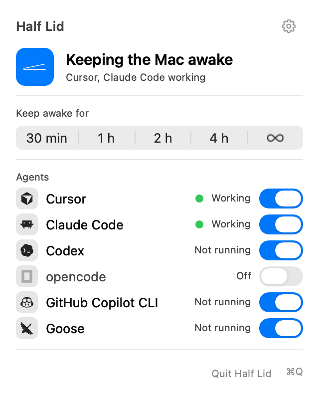
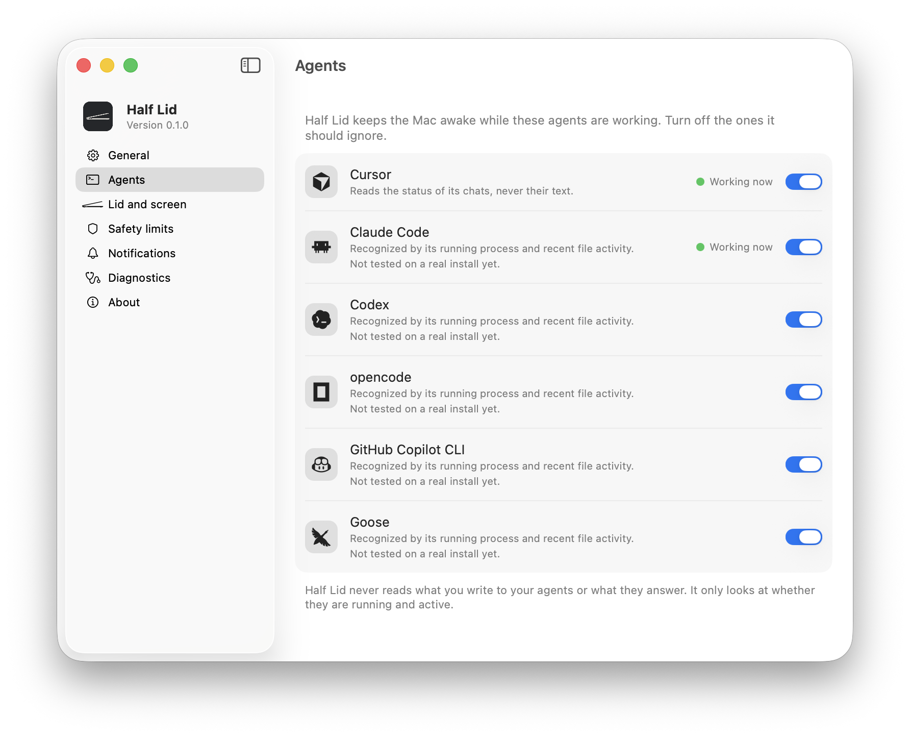

# Half Lid

Keeps your Mac working with the lid closed while your coding agents do.

You know the posture: laptop open at forty-five degrees, because closing it would put the Mac to sleep and the agent is
not done yet. Half Lid lets you close the lid. The Mac stays awake, the screen locks and goes dark, and when the work
ends (or the battery, the heat or the clock say enough) everything goes back to normal on its own.

It is a small menu bar app for macOS. No account, no network, no admin password, MIT licensed.

**Status:** version 0.1.0, the first release. It has been tested by its author on one Mac, with the lid really closed; what has
and has not been checked is listed under [Does it work?](#does-it-work).

<p align="center">
  <picture>
    <source media="(prefers-color-scheme: dark)" srcset="docs/screenshots/panel-active-dark.png">
    
  </picture>
  &nbsp;&nbsp;
  <picture>
    <source media="(prefers-color-scheme: dark)" srcset="docs/screenshots/settings-agents-dark.png">
    
  </picture>
</p>

<sub>The quick panel and the Settings window, made by `scripts/screenshots.sh` from the real programs with sample data (nothing
here is from anyone's Mac). The panel comes from the app's own preview mode, so its background is flat where the real one is
translucent. More: the panel during [a manual hold](docs/screenshots/panel-hold-light.png) and after
[a stop to protect the Mac](docs/screenshots/panel-stopped-light.png), and the
[Safety limits pane](docs/screenshots/settings-safety-light.png). Each has a dark version next to it.</sub>

## What it does

- **Watches your agents.** Cursor, Claude Code, Codex, opencode, GitHub Copilot CLI and Goose (only Cursor has been tested
  on a real install, see [Agents](#agents)). It only asks "is it working?", never "what is it working on?" (see
  [Privacy](#privacy)).
- **Keeps the Mac awake with the lid closed** while one of them is working, or while you ask for it (30 minutes, 1, 2 or
  4 hours, or until you stop it).
- **Locks the screen and turns the display off** when the lid closes, and puts the brightness back when it opens.
- **Lets go by itself.** When the work ends, the Mac goes to sleep with the lid closed as usual. Battery low, battery hot,
  the Mac running hot and a time limit all stop it too (defaults [below](#safety-limits)).
- **Cannot leave the Mac stuck awake.** A separate guard process undoes everything if the app dies, even with `kill -9`.

## Install

Requires macOS 14 or later. Developed and tested on macOS 26.5.2 on Apple Silicon; the Intel half of the download is built
but has never been run, and macOS 14 and 15 have not been tried.

**From a download.** Unzip `HalfLid-<version>.zip`, drag `HalfLid.app` to Applications and open it. The app is signed
ad hoc and is not notarized (that costs an Apple Developer subscription, which this project does not have), so macOS
refuses the first launch of a downloaded copy. Open System Settings, Privacy & Security, find the message about Half Lid
and choose Open Anyway. The same effect from a terminal: `xattr -dr com.apple.quarantine /Applications/HalfLid.app`.

**From source.** Needs the Xcode Command Line Tools (`xcode-select --install`), not Xcode. A copy you build yourself has
no quarantine flag and opens without the ritual.

```sh
git clone https://github.com/fedebartoli/halflid.git && cd halflid
scripts/make-app.sh
open build/HalfLid.app
```

The first time, a small panel opens under the icon to say where Half Lid lives. If you cannot see the icon, the menu bar
is probably full (the Mac hides what does not fit) or Half Lid is switched off in System Settings, Menu Bar. Opening the
app a second time brings the panel and the icon back.

## Using it

- **Click the icon** for the quick panel: the state, keep awake for a while, one row per agent with a switch, the gear for
  Settings and the power button to quit.
- **Right-click (or Control-click)** for the classic menu, which also has the lid options (lock, display off).
- **Settings** has seven panes: General (open at login, language, command line), Agents, Lid and screen (lock, display
  off), Safety limits, Notifications, Diagnostics (who is keeping this Mac awake, repair, a report to paste into a bug) and
  About.

Half Lid changes nothing on your Mac until an agent works or you ask. With nothing to do it sits at about 13 MB.

### Agents

| Agent | Status |
| --- | --- |
| Cursor | Tested on a real install. Half Lid reads the status of Cursor's chats (is a step running, is a question waiting for you). |
| Claude Code, Codex, opencode, GitHub Copilot CLI, Goose | **Experimental.** Recognised by process name and install path and by recent file activity, written from how each one is installed, not yet tested on a real install. Settings says so under each of them. |
| Gemini CLI, and other agents written as Node.js scripts | Not recognised yet: macOS reports them as `node`, and Half Lid does not read command lines. |

How the recognition works, what each rule rests on, which agents were looked at and left out, and how to test one on your own
install (15 minutes, no closed lid) are in [docs/AGENTS.md](docs/AGENTS.md). A test report is the most useful thing you can
send; there is an issue form for it.

### Command line

```sh
halflid status [--json]    # what Half Lid is doing; exit code 3 when it is not running
halflid start [30 | 2h]    # keep awake for 30 minutes, 2 hours, or until `halflid stop` without a duration
halflid stop
halflid repair             # put the lid behaviour and the display brightness back to normal
```

The tool is inside the app (`HalfLid.app/Contents/MacOS/halflid`); Settings, General, has a button that copies its path
so you can link it into your `PATH`. `start` and `stop` can be switched off in Settings. The text follows the system
language.

## Safety limits

Every limit can be changed in Settings. Values outside a safe range are corrected, so a typo cannot switch off a safety net.

| What | Default |
| --- | --- |
| Battery | warn at 30 %, stop at 20 %; resumes only on power or 5 points higher |
| Time | 4 hours on battery, 12 hours on power (opening the lid starts a new count) |
| Heat | stop when macOS reports a Serious thermal state or worse |
| Battery temperature | warn at 42 C, stop at 45 C once it has stayed there for a minute |
| After the work ends | waits 2 minutes, to ride out slow networks, then lets go |

## Privacy

Half Lid runs on your Mac and nothing leaves it: no account, no analytics, no update check, no network code at all.

- For **command-line agents** it sees which processes are running, how busy they are, whether they hold a sleep assertion
  and when their session files were last touched. It never reads those files or the agents' command lines.
- For **Cursor** it reads the status fields of its chats (is a step running, is a question waiting for you), read-only,
  and never the text of a message or the name of a chat.
- Notifications, if you turn them on, say what Half Lid is doing and never anything about your work.

## What it changes on your Mac

- A system setting that makes macOS ignore the closed lid, through an IOKit call that needs no administrator rights. It
  is the same call other tools use; it is not documented by Apple and a future macOS can change it. macOS's own power daemon
  writes the same setting and can switch it off (for instance when a monitor is unplugged), so while Half Lid is holding the Mac it
  makes the call four times a second, well under 0.1 % of one core by calculation (not measured with the real call); each call
  leaves a short line in macOS's system log.
- The screen is locked and the display put to sleep when the lid closes; the brightness is saved and restored. Locking and
  brightness use macOS functions that Apple does not document. If one is missing on a future macOS, Half Lid skips that
  step (without the lock the Mac stays unlocked behind the dark screen); Settings, Diagnostics, shows whether both exist on
  your Mac.
- Small files in `~/Library/Application Support/HalfLid`: your preferences, the last session (times and why it ended, no
  names), the saved brightness while the display is dark, and the status that `halflid status` reads while the app runs.
- Optionally a login item and notification permission, if you ask for them.

Everything is undone when the work ends, when you stop it, when you quit, and by the guard if the app disappears. If
something ever looks wrong, `halflid repair` or Settings, Diagnostics, Repair puts it right.

### Uninstall

Turn off Open at login in Settings, quit Half Lid from its panel, delete `HalfLid.app`, and optionally delete
`~/Library/Application Support/HalfLid`. Nothing else is installed.

## Measured

On macOS 26.5.2, Apple Silicon, release build, 2026-10-16. Memory is `phys_footprint` from `footprint` (the figure Activity
Monitor calls Memory); CPU is process time over 60 seconds. The lid override was not touched for the idle numbers.

| | Result |
| --- | --- |
| App size | 4.5 MB (8.5 MB with both architectures; the download is 2.7 MB) |
| Memory, every agent switched off | 11 to 13 MB |
| Memory, watching Cursor | 16 to 20 MB |
| CPU, every agent switched off | 0.17 to 0.18 % of one core |
| CPU, holding the Mac awake, watching Cursor | 0.75 % of one core |
| Internet sockets, in all four processes (when sampled) | 0 |

The panel and the Settings window are separate programs that exist only while they are open, so they cost nothing at rest.

Measured again on 2026-10-17, on the build with the final mark: the app size, and the resident app with every agent switched
off (11 MB after 30 seconds and 12 MB after 90, 0.17 % of one core over 60 seconds, no internet sockets; run with the file
stand-in for the lid override and an empty agent list). The rows about watching Cursor, and the sockets of the panel and the
Settings window, are from the previous build, before the mark was replaced by the traced drawings; they have not been measured
again. The row for holding the Mac awake predates the keeper that applies the lid override four times a second (see "What it
changes on your Mac"). Measured again on 2026-10-19 with the keeper, armed by the Cursor chat that was working, with the file
stand-in for the override (a file write per call, which costs more than the real call): 0.8 % of one core over 40 seconds and a
13 MB footprint, so the keeper does not show up in the noise. One run, not repeated.

## Does it work?

What has been checked, and what has not.

- **With the lid really closed, by hand, on this Mac:** in single closures it stayed awake on power and on battery (15 to 52
  seconds, and one of 29 minutes); the screen is locked and dark; after the override is released the Mac sleeps by itself, 7
  seconds later in the test; it is back to normal after every test.
- **A run that failed, and what was done about it (2026-10-19).** With Half Lid holding the Mac and an external monitor connected,
  three quick close-and-open cycles all put the Mac to sleep. macOS's own log showed why: its power daemon (`powerd`) writes the
  same flag Half Lid sets, and cleared it when the monitor's link dropped, 0.7 s before the lid closed, and again after each wake;
  Half Lid only re-applied it once a minute. It now re-applies it four times a second and at once on those events. This is checked
  by tests and by a real process against a file standing in for the flag, and on this Mac, with the lid: on 2026-10-20 the
  monitor was disconnected with Half Lid holding, powerd cleared the flag exactly as before, and Half Lid put it back 0.3
  milliseconds later; the four closures that followed (three quick ones and one of 3 minutes 34 seconds) kept the Mac awake with
  nothing else holding it (powerd's own state 0, no monitor), and the network answered every probe. Not checked: the same
  closures with Half Lid not holding (the control), and a clear that arrives after the lid has closed, which nothing can catch in
  time (the script says so by name if it happens). Details in [docs/FINDINGS.md](docs/FINDINGS.md), section 1b.
- **How to tell whether a closure proves anything.** With an external monitor in use on power, macOS may keep the Mac awake by
  itself, so a pass there says little about Half Lid: the first real run with the new build was like that, and the report said so.
  Disconnect the monitor, run `scripts/lid-check.sh` with Half Lid holding and close the lid; then, to be sure, do the same with
  Half Lid not holding: the first must stay awake and the second must sleep. The report prints what macOS's power daemon thought
  at each closure and says when a run cannot tell.
- **Seen from the outside, with your own closure:** `scripts/lid-check.sh` (in the repository, not in the zip) watches the lid, Half
  Lid's state, the network and macOS's own power log while you close and open the lid, then says whether the Mac kept running or
  slept; afterwards it reads macOS's system log for the same minutes and shows what the override was when the lid closed and who
  changed it. Every 5 seconds it sends a small request to captive.apple.com, the address macOS itself uses to check the network; pass
  `--no-network` to skip that. It only watches and needs no sudo.
- **With the real app:** the panel, the Settings window (opened from the gear, in front of the other windows), the first-run
  welcome, Cursor detection while a chat works, and the numbers in the table above.
- **By the automated tests** (more than 5,000 checks): the limits against a simulated clock, battery and heat; the guard
  restoring everything after `kill -9` and after a hung app, with a file standing in for the lid override; the twelve
  languages; the command-line control; what each process sends the others.
- **Not checked yet:** the control run (the same closures with Half Lid not holding); a clear after the lid has closed (never seen); hours with the lid closed; an agent finishing a job while the lid stays closed for minutes (the script shows
  that the Mac and the network keep running, which the job needs, not the job itself); a really empty or really hot battery; a forced power-off while armed; Claude
  Code, Codex, opencode, GitHub Copilot CLI and Goose on real installs (their recognition is written from how each is installed
  and is marked unverified in `Resources/agents.json`, see [docs/AGENTS.md](docs/AGENTS.md)); notifications from permission
  prompt to banner; Open at login; macOS 14 and 15; Intel Macs.

Details and the evidence are in [docs/FINDINGS.md](docs/FINDINGS.md) and [docs/DECISIONS.md](docs/DECISIONS.md).

## Alternatives

Half Lid is one of several tools for the same job. As far as their own pages say (October 2026):

- **Amphetamine** (free, Mac App Store) is a general keep-awake tool with triggers and a closed-display mode.
- **Hold My Lid** (paid, closed source) learns whether Claude Code, Codex or OpenCode is working from the hooks those agents
  expose.
- **Lidless, Sleepless, Insomnia, LidAwake, StayAwake** and others (open source) switch the system's `disablesleep` flag (what
  `pmset -a disablesleep` sets), which needs administrator rights, so they install a privileged helper or a `sudoers` rule, or
  ask for the password. StayAwake also watches Claude Code, Codex and Cursor.

What Half Lid does differently: it needs no password, no `sudoers` rule and no helper (an IOKit call as your user, with a
separate guard process that puts everything back if the app dies), it installs no hooks in any agent, and it reads Cursor's
chat state to tell a working chat from one waiting for you. What it does not have: a track record. It has been run on one Mac.

## Languages

English, Italiano, Español, Français, Deutsch, Português (Brasil), 日本語, 简体中文, 繁體中文, 한국어, Русский and Türkçe,
following the system language or the one chosen in Settings. Corrections are welcome, especially from native speakers.

## Build and test

```sh
scripts/build.sh          # the four programs, in build/bin
scripts/test.sh           # the automated checks; exit code 0 means all passed
scripts/make-app.sh       # build/HalfLid.app, signed ad hoc
scripts/package.sh        # build/dist/HalfLid-<version>.zip and its checksum
scripts/lid-check.sh      # watches a closure of the lid from outside; it asks you to close and open the lid
scripts/screenshots.sh    # the pictures in docs/screenshots, from the real programs with sample data (briefly takes the focus)
```

Built with `swiftc` only: no SwiftPM, no Xcode project, no third-party code. SwiftPM does not work on every Command Line
Tools install (see FINDINGS). The code is in `Sources/` (`HalfLidCore` is the part that decides; the rest is windows).

## Contributing and security

Bug reports, agent test reports and corrections to a translation are welcome; the issue forms say what to include, and
[CONTRIBUTING.md](CONTRIBUTING.md) says how to build, test and what a change has to keep. A vulnerability is not a public
issue: see [SECURITY.md](SECURITY.md).

## License

[MIT](LICENSE). The name, the mark and how to talk about them are in [docs/BRAND.md](docs/BRAND.md). The logos of the agents are the property of their owners and are shown only to say which agent a row is
about; Half Lid is not affiliated with, endorsed by or sponsored by any of them. Where each logo comes from and under which
licence is in [NOTICE](NOTICE).
